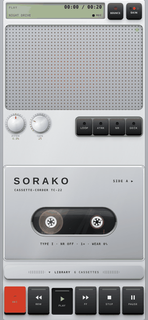
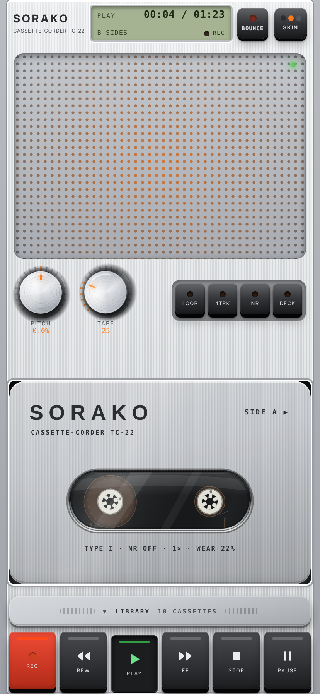
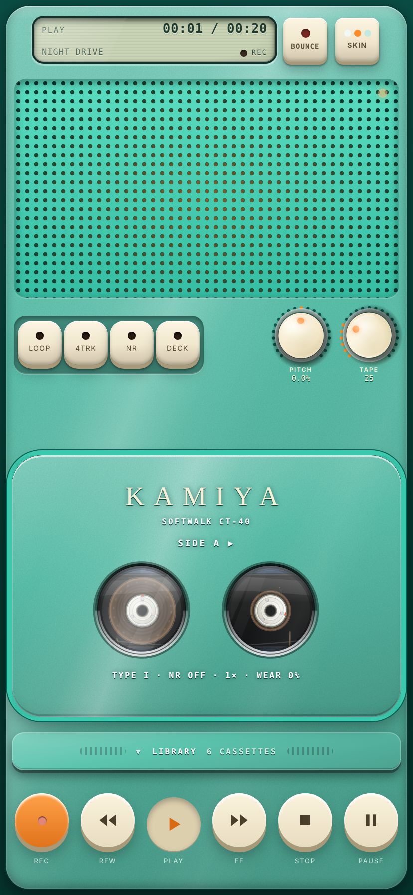
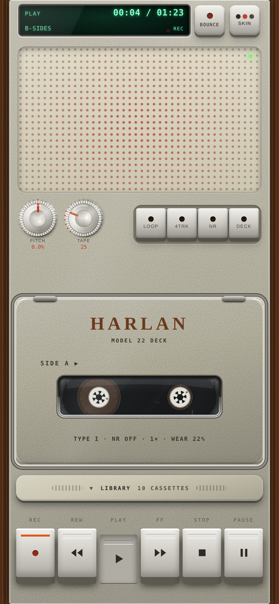
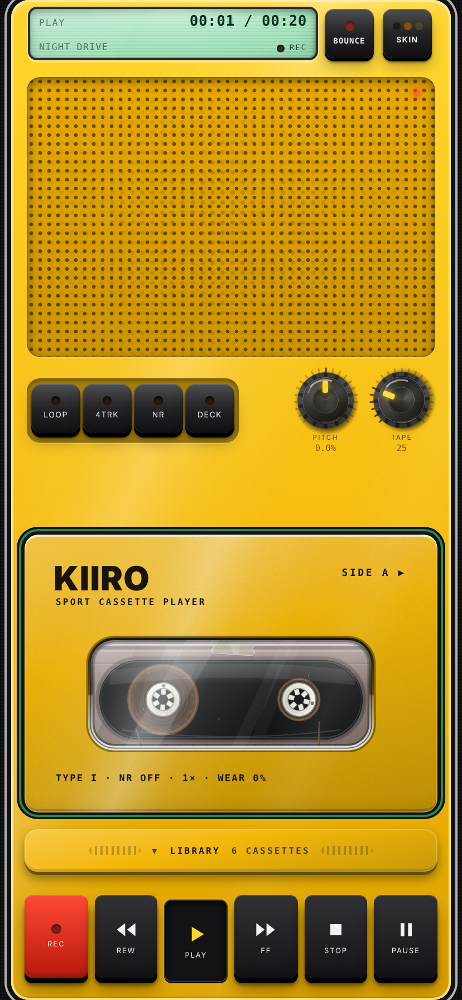
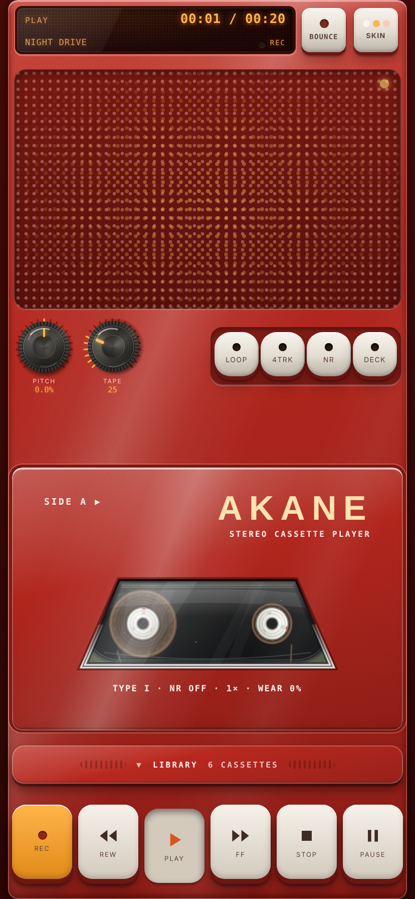
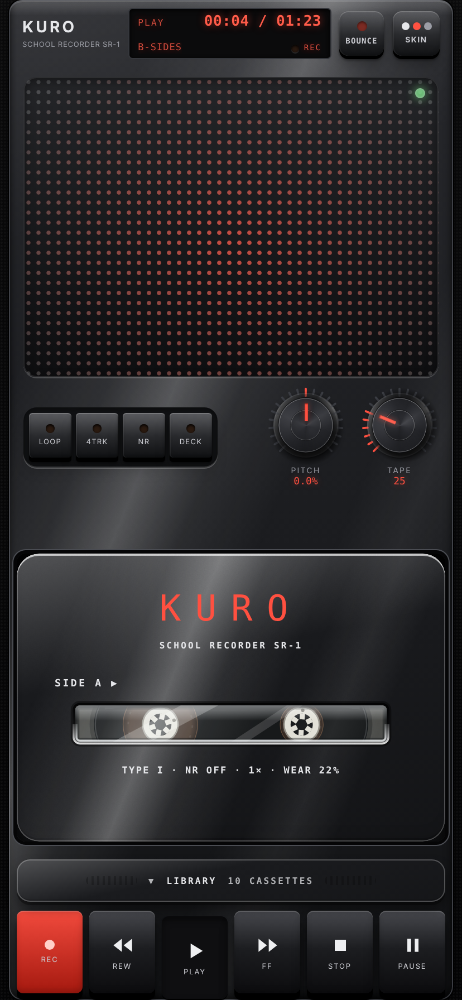
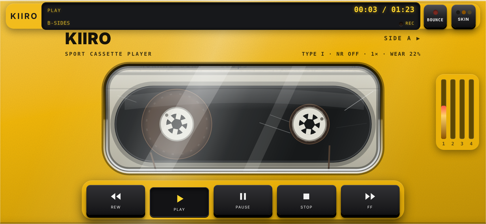
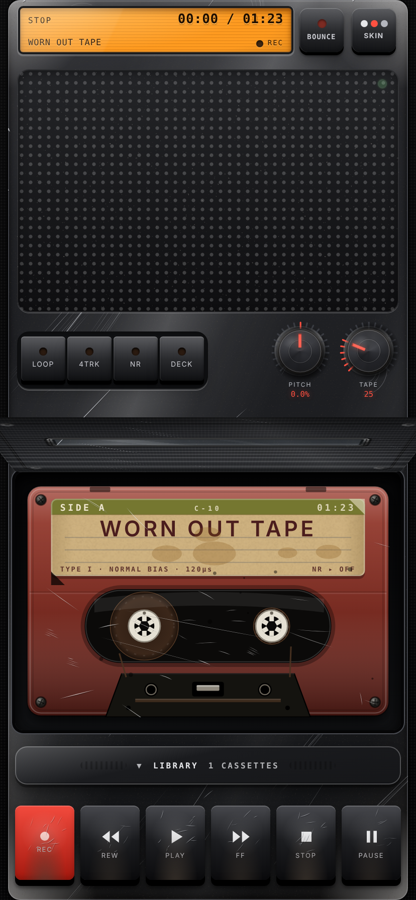

# HISS

A cassette deck in your pocket. One HTML file, works on iPhone in Safari and offline. English by default, Russian optional (DECK → LANGUAGE).

Load your own audio, swipe the lid open, spin the reels with your finger, record on 4 tracks and bounce them down with generation loss. The tape ages: the more you play it, the darker and noisier it gets. A short intro tour runs on first launch (replay it any time from DECK → HOW TO USE).



<details>
<summary><b>All six skins, full size</b></summary>

| | |
|---|---|
|  |  |
|  |  |
|  |  |

</details>

Landscape visual mode (the cassette sits in a lid set into the plastic body, in the skin's colour):



## Decks

Six pocket-recorder skins, each with its own colours, construction and cabinet sound:

- **SORAKO TC-22**: Japan, silver, black piano keys, red REC
- **KAMIYA CT-40**: Japan, matte teal shell, lilac keys, orange REC
- **HARLAN M60**: USA, cream deck with printed key labels, wood sides
- **KIIRO KR-10**: black rubber frame, yellow plate, yellow encoders
- **AKANE AK-1**: red anodised metal, rounded cream keys
- **KURO SR-1**: black school recorder, glossy black keys, red REC cube

All skins share one body: a big speaker grille with a level LED on top, the window below, keys at the bottom. Swipe up on the glass to open the lid, swipe down to close it. PITCH and TAPE sit side by side on the front strip; opposite them, on a recessed plate, are LOOP / 4TRK / NR / DECK (the side alternates between skins). Double-tap a knob to reset it. The open lid folds back above the window like a real flap.

## Features

- **4 tracks** per side: ARM, faders, MUTE, record from the mic onto the chosen track
- **PING-PONG**: bounce tracks into one, with generation loss
- **Sides A/B**, hand-written cassette labels, **J-card** export to PNG
- **Cassette materials**: every cassette has its own reels (**teeth**, **smooth** or **clear**), its own plastic (**gloss**, **smoked** translucent or **clear**: the liner sheet and screw bosses show through) and its own history: scotch tape strips and peeled-tape smears, a **DEMO** rubber stamp, pen notes, a crossed-out old title, a signature. All of it is seeded by the cassette id; pen, stamp and tape fade and yellow with wear. Change reels and shell in the 4TRK sheet (REEL / SHELL).
- **Window backlight**: while the lid is closed, a lamp behind the cassette lights the window so the reels stay visible (the colour belongs to the skin, it is dimmer at rest, full while the tape runs and red while recording).
- **Tape wear**: every cassette has its own history, and it shows: scratches, tea stains, curled label corners, fading ink, darker sound. Wear is permanent until you press NEW TAPE in the 4TRK sheet
- **Cassette life**: each tape carries a generation stamp on its label (G1 is the original; every PING-PONG or DUB adds one) and keeps its own history of plays and hours, printed on the J-card. DUB TAPE (4TRK sheet) copies the whole cassette onto a new one, one generation down, with the same tape loss as a ping-pong, so a copy sounds worse than its source. The TAPE encoder sets how much tape character you hear, and the higher it is the faster the cassette ages.
- **Display windows**: six display technologies (LCD, VFD, EL, LED matrix) in one depth system: recessed glass, 2 px bezel, unlit segments, uneven backlight, a faint refresh shimmer on the LED and VFD skins, and long track names slide instead of being cut.
- **Wear**: the deck itself ages with the hours it has played (about ten hours for a full set): scratches on the plate, flaked paint at the edges, rubbed keys, grime on the knobs. Cassettes wear on their own, too, so an old tape shows scratched glass, stained paper and curled label corners.



- **Lock screen and headphones**: the current cassette shows up in Now Playing with play, pause and stop (a silent audio element keeps the media session alive on iOS; the sound itself is Web Audio).
- **Clear errors**: a file that is not audio, too large (over 150 MB), unreadable, a full browser storage or a refused microphone each say so on the display.
- **Deck wear**: the machine ages with the hours it has played (about 10 h to full): fine scratches, grime at the edges, worn keys, dust on the grille. DECK → MORE → SERVICE DECK resets it.
- **LOOP**: a loop that crumbles a bit on every pass
- **BOUNCE**: save everything you hear to WAV
- Key and encoder sounds: recorded samples ship in `sounds/` (each deck has its own set of key down/up sounds, picked to match its build); anything missing falls back to a physical-model synth, and you can replace the samples with your own
- **Encoders** (PITCH, TAPE) are heavy: dry micro-clicks per step, and a hard flick keeps them spinning on inertia until friction stops them
- Cassette shelf with edit mode (delete cassettes) that shows two rows and scrolls, output limiter, landscape visual mode
- **Tablets**: on an iPad in portrait the deck is scaled up to the screen height and centred ; in landscape iPad switches to the full-screen cassette mode with side panels

### DECK settings

**NR** (quick Dolby toggle) and **DECK** (settings sheet) sit next to LOOP / 4TRK.

- **Tape type** I / II / IV: changes highs, lows, hiss and saturation; printed on the label.
- **Dolby NR** OFF / B / C: less hiss, slightly softer highs.
- **Speed** ½ / 1× / 2× (recording is always 1×).
- **TONE**, **VOLUME**, **BALANCE**.
- **REC LEVEL** with soft limiting and a PEAK LED while recording.
- **AUTO REV**: at the end of a side the deck flips the cassette and keeps playing.
- **MEMORY**: rewind stops at counter zero (RESET).
- **CUE**: hear the wind (off: a quiet rustle).
- **SLEEP** 15 / 30 / 60 min: fade out and stop.
- **LANGUAGE** EN / RU, **HOW TO USE** (replays the tour).

Settings are stored on the device.

### Library cover

The cassette shelf hides behind a small plastic cover under the window (it prints the number of cassettes). Swipe the cover down to open the library, pick a tape and it closes again; DECK → **LIBRARY** switches between COVER (default) and OPEN (shelf always visible).

### Lid style

DECK → **LID**: CLOSED (default) or WINDOW (glass over the whole cassette). CLOSED is a moulded plastic cover with a differently shaped window per skin (pill, two portholes, letterbox, big rounded window, trapezoid, slot). The cassette title stays on the cassette itself. Works in portrait and landscape (in landscape the window is re-mapped onto the full-screen cassette).

### Landscape mode

Rotate the phone and the cassette fills the screen. Controls (REW, PLAY, PAUSE, STOP, FF), the header and four track level bars sit on glass panels that auto-hide after a few seconds of playback. Tap the screen to bring them back; a thin strip at the bottom shows they are hidden. Tapping the levels opens 4TRK. The DECK, 4TRK and skin sheets slide in from the side.

## Custom key sounds

Put samples in a `sounds/` folder next to `index.html` and describe them in `sounds/index.json`:

```json
{"all":{"down":"down.mp3","up":"up.mp3","latch":"latch.mp3","insert":"insert.mp3","big":"stop.mp3"},
 "nashville":{"down":"harlan_down.mp3"}}
```

`all` applies to every deck; a deck id (`studio`, `sonic`, `kami`, `ulm`, `helsinki`, `nashville`) overrides it for that deck. Sound kinds: `down`, `up`, `latch`, `insert`, `big`, `enc`, `tick`, `toggle`.

## Install

iPhone: Safari → Share → Add to Home Screen. The app works offline after the first load.

## Publishing

GitHub Pages serves the **root** `index.html` (already built, one file with all styles and scripts), plus `sw.js`, `manifest.webmanifest`, `icons/` and `sounds/`. The `src/` folder is only needed for development; do not publish `src/template.html` as `index.html` (it has no styles or scripts, only placeholders).

## Development

```
src/template.html   page template (markup, NOT the file to publish)
src/css/*.css       styles, concatenated in filename order
src/js/*.js         script parts, concatenated in filename order into one scope
tools/build.py      builds ./index.html (the single file GitHub Pages serves)
sw.js               service worker (bump the cache version V on release)
manifest.webmanifest, icons/
```

```
python3 tools/build.py            # rebuild index.html after editing src/ (comments and indentation stripped)
python3 tools/build.py --dev      # same, but readable
python3 tests/smoke.py            # headless boot / skins / tour check (needs playwright)
python3 tools/build.py --check    # exit 1 if index.html is stale
```

Serve the folder with any static server (for example `python3 -m http.server`) and open `index.html`. Open it with `#dev` appended to the URL to expose the `window.__tape4` debug hook. Always commit the rebuilt `index.html`.

**GitHub Pages:** push the repository, then Settings → Pages → Deploy from branch → `main` / root.

## License

[MIT](LICENSE) © 2026 Kirill Kinderhart
